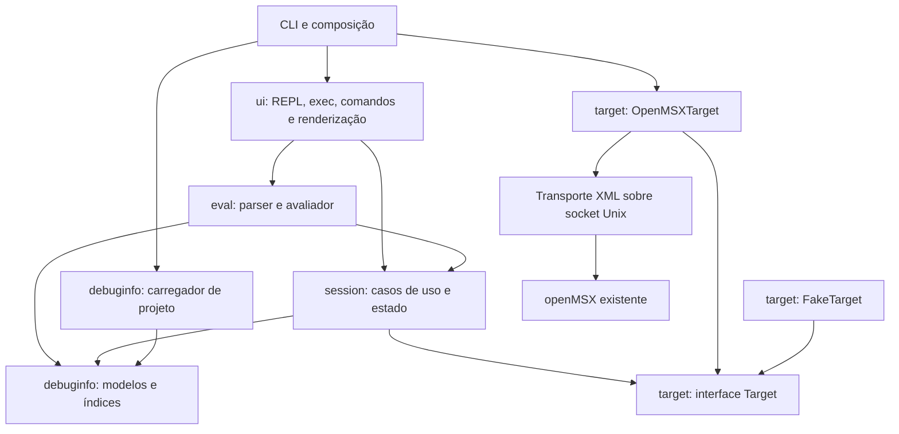
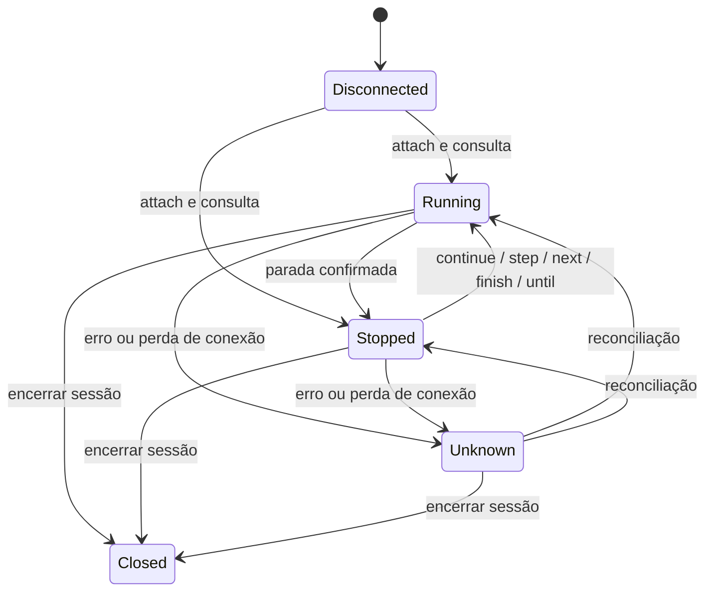

# Arquitetura do msxdbg

Proposta baseada integralmente em `SPEC.md` (2026-09-25, referência v1.2c0).
Este documento define a reescrita; não descreve uma implementação já existente.
O diretório disponível contém a especificação, sem código ou fixtures da versão anterior.

## 1. Objetivo e decisões centrais

O msxdbg será um depurador de programas Z80 compilados com SDCC, com resolução offline de símbolos e depuração por conexão a um openMSX já em execução. Deve funcionar com várias imagens ligadas separadamente e preservar a interface conhecida pelo usuário.

A implementação será um pacote Python 3.9+, organizado como um monólito modular. Não há necessidade de servidor próprio, banco de dados ou serviços distribuídos: os artefatos de compilação são a fonte persistente de informação, e a sessão de depuração vive em memória. `prompt_toolkit` cuidará da interação e `rich` da apresentação textual; o núcleo não dependerá dessas bibliotecas.

Decisões propostas:

- Separar informação estática do programa, acesso ao emulador, controle da sessão, avaliação de expressões e interface.
- Representar identidade de imagem e módulo em todas as consultas e caches relevantes.
- Retornar ambiguidades e indisponibilidade explicitamente, sem escolher silenciosamente um resultado.
- Compartilhar os mesmos casos de uso entre o REPL e o modo de agentes.
- Concentrar segurança e invalidação de estado no núcleo da sessão.
- Manter transporte simples inicialmente; habilitar otimizações somente após validar o protocolo instalado.

## 2. Componentes e dependências

As setas abaixo significam “depende de”. O fluxo dos dados ocorre também no sentido inverso, por retornos tipados.



`debuginfo` e a interface `Target` são independentes. `session` não importa `eval` nem `ui`; o avaliador usa uma visão de leitura da sessão, evitando dependência circular. A composição no CLI injeta implementações e configurações. `resolve` instancia apenas os componentes offline.

| Componente | Responsabilidade | Limite |
| --- | --- | --- |
| `debuginfo` | Ler artefatos, reconciliar registros, indexar endereços, tipos e fontes | Não consulta o emulador |
| `target` | Traduzir operações tipadas para openMSX; fornecer implementação falsa | Não interpreta símbolos ou tipos C |
| `session` | Controlar execução, paradas, breakpoints, frames e permissões | Não formata saída nem analisa comandos textuais |
| `eval` | Transformar expressões em AST, resolver valores e localizações | Não controla execução nem escreve no terminal |
| `ui` | Interpretar comandos, completar, apresentar resultados e erros | Não emite Tcl nem acessa socket diretamente |

## 3. Organização do pacote

```text
msxdbg/
  __main__.py               # argparse e composição
  debuginfo/
    model.py               # Image, Module, Function, Variable, Type
    diagnostics.py         # problemas com origem e severidade
    loader.py              # descoberta, overrides e reconciliação
    map_parser.py
    lst_parser.py
    cdb_parser.py
    header_parser.py
    macros.py              # definições e catálogo contextual de macros
    index.py               # endereços, linhas, nomes e ambiguidades
    sources.py             # localização e leitura de fontes
  target/
    api.py                 # Protocol Target e DTOs do Z80
    openmsx.py             # construção de operações Tcl
    transport.py           # conexão, XML, timeouts e respostas
    fake.py
  session/
    core.py                # casos de uso e máquina de estados
    state.py               # StopSnapshot e contextos de leitura
    results.py             # resultados tipados dos casos de uso
    breakpoints.py
    execution.py
    frames.py
    safety.py
    memory_map.py          # páginas, slots e relatório de page3
  eval/
    tokens.py
    macros.py              # expansão limitada de tokens com proveniência
    ast.py
    parser.py
    evaluator.py
    values.py              # decodificação e disponibilidade
  ui/
    registry.py
    commands.py
    results.py             # resultados e erros de comandos
    repl.py
    batch.py
    render_text.py
    render_json.py
tests/
  fixtures/
  unit/
  scenarios/
  golden/
  integration/
```

Os arquivos são divisões propostas de responsabilidade, não uma exigência de criar módulos vazios antecipadamente.

## 4. Modelo de informação do programa

### Identidade e endereços

`Project` reúne uma lista de `Image`. Cada `Image` corresponde a um binário ligado independentemente e possui seu próprio conjunto de `.map`, `.lst` e `.cdb`.

| Registro | Campos essenciais |
| --- | --- |
| `ImageSpec` | id explícito ou derivado, diretório de saída, listas de maps/cdbs, raízes de fontes |
| `Image` | id, módulos, áreas, símbolos, funções, tipos, diagnósticos |
| `ModuleId` | image_id, identidade do módulo |
| `FunctionId` | ModuleId, identidade completa do registro CDB ou identidade de fallback |
| `VariableId` | ModuleId, identidade CDB incluindo função, nível e bloco |
| `CodeLocation` | image_id, module_id, área, endereço, offset, arquivo, linha, função opcional |
| `SourceSpan` | caminho original e normalizado, linha, texto opcional |
| `Resolution` | resultado único, não encontrado ou candidatos ambíguos; evidências e avisos |

Endereços de CPU pertencem a `0x0000..0xFFFF`. Limites exclusivos de intervalos podem usar `0x10000`. Offset de área, endereço ligado e endereço de CPU são conceitos distintos; a conversão fica no indexador. Intervalos internos usam `[início, fim)`; saídas inclusivas do CDB são convertidas na carga.

Identidades não dependem apenas do nome da função. Caches de análise usam ao menos imagem, módulo, função e geração de memória. Isso elimina colisões entre funções `static` e entre imagens.

### Carga e reconciliação

1. Construir `ImageSpec` e descobrir arquivos de cada imagem deterministicamente.
2. Executar parsers independentes, preservando arquivo, linha física e registro de origem.
3. Relacionar registros `L:` aos registros `F:`/`S:` por identidade completa; processar todos os CDBs associados à imagem.
4. Calcular bases por módulo e área a partir de labels exportados e endereços do map. Usar o candidato majoritário de `_CODE`, preservando e exibindo conflitos.
5. Construir índices de funções, linhas, símbolos, blocos e tipos. Usar CDB para informação que ele fornece validamente; preencher lacunas com LST e MAP. Divergências geram diagnóstico com ambas as origens.
6. Resolver tipos de CDB `T:` quando suportados; usar headers como fallback, registrando diferenças de layout em vez de misturá-las silenciosamente.
7. Construir catálogo de macros de objeto e com parâmetros a partir de fontes/headers explicitamente carregados; preservar tokens, proveniência e contexto por imagem/unidade de compilação. Não tratar condicionais desconhecidos como definições ativas.

Os parsers retornam dados e diagnósticos, sem imprimir. Um registro inválido não elimina os registros independentes válidos; ausência dos artefatos essenciais ou bases inutilizáveis impede as consultas afetadas com motivo explícito.

Na primeira entrega, a resolução cobre `_CODE`. Outras áreas só serão habilitadas quando houver evidência suficiente de relocação e limites. O limite legado `last_known_offset + 16` pode ser mantido como fallback identificado, nunca apresentado como extensão comprovada do código. A última função sem marcador de saída não se estende indefinidamente: usa limite comprovado de área quando disponível; caso contrário, informa confiança insuficiente fora da região conhecida.

### Consultas e ambiguidades

- Propriedade de módulo deriva de bases e intervalos, nunca do símbolo público mais próximo.
- `file:line` compara componentes de caminho; `map.c` não corresponde a `worldmap.c`.
- Linha sem instrução avança para a próxima linha com código no arquivo selecionado e retorna a linha efetivamente usada.
- Nomes C aceitam o alias sem `_`. Primeiro procura-se nome exato; colisões entre aliases são reportadas.
- Consultas retornam todos os candidatos relevantes entre imagens; a UI solicita qualificação quando necessário.
- A proposta de qualificação é `image::symbol` e `image::file:line`. O parser separa `::` antes de analisar o sufixo de linha.
- Breakpoints continuam sendo por endereço do barramento. Qualificar uma imagem resolve um símbolo, mas não restringe o segmento de mapper que disparará o breakpoint.

### Configuração de múltiplas imagens

Preservar `--out`, `--map` e `--cdb` para projetos de imagem única. Com vários `--out`, descoberta automática continua válida; overrides sem associação explícita devem gerar erro útil, em vez de serem aplicados a todas as imagens.

Adicionar `--project FILE` com um manifesto JSON versionado, lido com a biblioteca padrão. Cada entrada contém `id`, `out`, `maps` e `cdbs`; caminhos relativos são resolvidos contra o diretório do manifesto. `source_roots` e headers podem ser globais. Isso evita uma dependência TOML adicional para Python 3.9. O esquema exato será entregue junto ao CLI multi-imagem.

## 5. Acesso ao openMSX

### Contrato Target

A interface expõe operações como `read_registers`, `read_memory`, `disassemble`, `execution_status`, `continue_execution`, `step_into`, `step_over`, `step_out`, `run_to`, `interrupt`, `create_breakpoint`, `remove_breakpoint` e `read_pages`.

Operações de execução retornam confirmação de aceitação; somente `execution_status` confirma uma parada. `reset`, `save_state` e `load_state` são operações especiais acessíveis pela sessão após aplicar sua política. Escrita de memória não será exposta na primeira versão, pois não há comando correspondente no escopo atual.

O contrato usa DTOs tipados e exceções como `TargetUnavailable`, `TargetTimeout`, `TargetCommandError` e `TargetProtocolError`. Nenhum caso de uso depende de strings Tcl ou de detalhes do XML.

### Transporte e eficiência

- Descobrir socket pelo critério legado de mtime; aceitar `--socket` para seleção explícita e informar qual foi escolhido.
- Nunca iniciar openMSX nem alterar mídia, boot ou velocidade.
- Construir Tcl a partir de operações conhecidas. Valores textuais precisam de quoting Tcl; o comando completo precisa também de escape XML. São proteções distintas.
- Interpretar XML incrementalmente, incluindo respostas fragmentadas e eventos não solicitados. Associar respostas a uma única requisição pendente por conexão.
- Aplicar timeout de operação, inicialmente 5 segundos como no legado.
- Começar com conexão por comando. Após validação, selecionar conexão persistente por capacidade, mantendo fallback.
- Buscar registradores em lote e memória em blocos. Validar `binary encode hex [debug read_block ...]`; manter leitura agregada em Tcl como fallback.
- Não repetir automaticamente operações mutáveis após timeout: o emulador pode tê-las aplicado antes de perder a resposta.

Não haverá paralelismo de comandos de controle. O polling cooperativo permite Ctrl-C sem introduzir concorrência sobre a execução da CPU.

## 6. Sessão, execução e consistência

### Máquina de estados



`Running` inclui a fase de espera de uma operação aceita; a CPU pode parar imediatamente. Falha de comunicação não significa CPU parada. Leituras que exigem consistência são recusadas em `Running`/`Unknown`.

Cada parada confirmada cria um `StopSnapshot` com `stop_id` monotônico, registradores, localização resolvida, status da assinatura, motivo conhecido da parada e frame selecionado inicialmente zero. Caches associados guardam memória por faixa, frames e análise de prólogo/epílogo.

Ao retomar, invalidar o snapshot antes do envio. Na próxima parada, criar uma geração nova. `reset`, `load`, reconexão e futuras escritas também invalidam estado; reset/load rearmam a verificação de assinatura. Esta última decisão corrige o risco de confiar em uma assinatura vista antes de trocar o estado da máquina.

Antes de uma inspeção, conferir se o alvo continua parado. Como outros clientes podem controlar openMSX, não há atomicidade garantida entre chamadas; se a execução mudar durante a coleta, descartar o resultado. Registrar essa limitação de concorrência externa.

### Fluxo comum de execução

1. Validar comando, alvo e permissões.
2. Invalidar dados anteriores e emitir a operação uma única vez.
3. Consultar parada a cada 50 ms, incluindo `finish`.
4. Em Ctrl-C ou timeout, enviar interrupção e confirmar a parada antes de ler registradores.
5. Criar snapshot, verificar assinatura, resolver PC e retornar `StopResult`.
6. A UI apresenta texto ou JSON a partir do mesmo resultado.

O step por linha mantém o limite de 20.000 iterações. Compara imagem, módulo, arquivo e linha, parando também em localização desconhecida, breakpoint ou interrupção. Atingir o limite retorna motivo explícito, sem simular sucesso de mudança de linha.

A assinatura é uma evidência de carregamento, não autenticação do programa. Enquanto não corresponder, não produzir valores C confiáveis. A continuação automática até assinatura fica para uma fase posterior e exigirá comando explícito com limite de tempo ou tentativas.

### Breakpoints e encerramento

`BreakpointRecord` guarda número local monotônico, endereço, localização resolvida na criação, id remoto e estado (`active`, `suspended`, `unknown`). Uma operação só atualiza o estado local após confirmação remota; timeout exige reconciliação, sem nova criação automática.

Suspender remove remotamente e preserva o registro. Retomar recria no mesmo endereço. Excluir remove remotamente antes de apagar o registro. A sessão mantém um inventário dos ids que criou e nunca remove breakpoints de outros clientes.

Quit, EOF e exceções tratáveis passam por `finally`, tentam remover os breakpoints próprios e fecham o transporte. Falhas são apresentadas com os ids possivelmente remanescentes. Não é possível garantir limpeza após SIGKILL, queda do processo ou perda definitiva do socket; o sistema não afirmará essa garantia. Encerrar não dispara reset, load ou retomada automática da CPU.

### Segurança de reset e load

O registro de comandos declara `repeatable=False` e confirmação humana obrigatória. A sessão também exige autorização de uso único, emitida apenas pelo adaptador interativo após a entrada literal `reset yes` ou `load yes`. Histórico e repetição não produzem autorização; `exec` recusa essas operações mesmo com `yes`.

Detectar TTY sozinho não comprova presença humana, pois agentes podem controlar um terminal. A restrição é parte do contrato do produto e das integrações; não se deve anunciá-la como barreira de autenticação. Não haverá bypass `--force` ou autorização persistente.

## 7. Frames e variáveis

O serviço de frames usa CDB para funções e escopos, Target para memória e instruções e um analisador específico do ABI SDCC Z80 para prólogo e epílogo.

- Reconhecer `push ix; ld ix,#0; add ix,sp` e caminhar pela cadeia de IX.
- Limitar a 64 frames e detectar ciclos, endereços inválidos e funções desconhecidas.
- Usar `return_address - 1` para contexto do chamador, preservando separadamente endereço exibido e PC de consulta.
- Recusar registradores de frames chamadores; só o frame vivo possui registradores disponíveis.
- Preservar a regra documentada para parâmetros: bloco sem registros de linha.
- Representar disponibilidade como valor, otimizado, localização desconhecida, frame não suportado ou informação insuficiente.

Encontrar um `pop ix` em ordem estática não comprova que ele foi executado. O analisador deve usar apenas padrões que consegue demonstrar; em caminhos ambíguos, retorna estado desconhecido. Cache reduz custo, mas não torna a heurística correta.

O fallback `SP + offset - 2` só é válido quando for possível demonstrar que SP ainda corresponde à entrada. Caso contrário, o valor fica indisponível. Essa decisão é deliberadamente mais conservadora que o legado.

O relatório de page3 recebe um `MemoryLayoutPolicy` configurável: símbolos de início de dados/heap, obtenção do topo do heap e da TPA. `_g_HeapStartAddress` pode existir em um perfil de compatibilidade, mas não será requisito do núcleo. Sem evidência de um limite, o relatório mostra “desconhecido”, em vez de calcular espaço livre a partir de zero. Todos os intervalos são validados antes de calcular tamanhos.

## 8. Expressões e tipos

Um tokenizer lê o argumento completo, preservando espaços; um parser produz AST com precedência explícita. Não usar `eval` do Python, inclusive para macros de headers: aceitar apenas a gramática aritmética documentada.

Na primeira etapa, oferecer cálculo aritmético, registradores, leitura explícita com colchetes e compatibilidade de leitura com tipo/indexação explícitos. Parênteses sem tipo passam a ser agrupamento, não leitura indireta. A forma preferida de formato será `print/u16 expr`; `print expr u16` permanece como compatibilidade quando o último token for inequivocamente um tipo conhecido. Argumentos ambíguos recebem erro e sugestão da forma explícita.

Os requisitos F17/F18 de [BACKLOG.md](BACKLOG.md) ampliam print: expressão aritmética sem tipo explícito calcula um valor, `hex(expr)`/`bin(expr)` escolhem apresentação, e `[expr]` indica leitura de memória. Parênteses são agrupamento na calculadora. Preservam-se as leituras legadas com tipo explícito, como `print 0xC000 u16`, e o símbolo MAP isolado `print _sym`. Essa regra substitui a proposta anterior de indirection por parênteses sem tipo.

Macros de objeto e com parâmetros são expandidas por tokens antes da AST, a partir de definições com origem e contexto conhecidos. `debuginfo/macros.py` mantém o catálogo offline; `eval/macros.py` expande com limites e diagnósticos. Não confundir expansão de macro com chamada de função do programa; NLV só é resolvida se sua definição estiver carregada. Pré-processamento condicional desconhecido e recursos não suportados não são adivinhados.

Cálculos constantes não exigem acesso ao target nem snapshot. O avaliador identifica as dependências da expressão expandida antes de solicitar contexto de inspeção. Resultados de cálculo preservam inteiros sem máscara; apenas conversões explícitas para endereço aplicam a regra de 16 bits.

A etapa tipada aceita `*p`, `&x`, `a[i]`, `s.f` e `p->f` com tipos CDB. O avaliador distingue `AddressValue`, `ScalarValue` e `LValue(type, location)`, evitando tratar toda expressão como um inteiro sem tipo. A localização continua dependente do frame selecionado; caller não reutiliza registradores vivos do frame atual.

Regras de valor:

- Aritmética intermediária inteira e divisão truncada em direção a zero; máscara de 16 bits na conversão final para endereço, conforme compatibilidade.
- Limites de leitura definidos para strings, arrays e structs; strings até 256 bytes, arrays exibem até 16 elementos.
- Decodificação little-endian; layout sem padding somente sob o perfil ABI documentado.
- Tipos incompletos e ponteiros sem formato adequado não recebem defaults inventados.
- Variáveis em registradores trazem a ressalva de ausência de live ranges.
- `f32` representa IEEE-754 binary32 little-endian, validado por bytes gerados pelo SDCC 4.6.0 para Z80; versões/targets diferentes exigem nova evidência.

## 9. Comandos e contrato JSON

Cada `CommandSpec` define nome, aliases, gramática, ajuda, completador, handler, repetibilidade e requisitos de estado/segurança. Help e Tab usam esse registro único. `list` e `disassemble` mantêm cursores tipados de navegação fora do snapshot; seleção de frame pertence ao contexto da parada.

Handlers retornam `CommandResult`; renderizadores nunca executam operações do alvo. Strings de símbolos e fontes são escapadas no renderizador Rich, sem contaminar o modelo.

`msxdbg exec ... -c '...' --json` produz JSON Lines: exatamente um envelope por comando executado. Mensagens de diagnóstico adicionais vão para stderr; stdout permanece parseável.

```json
{"schema_version":1,"command_index":0,"command":"where","ok":true,"data":{"stop_id":3,"pc":39285,"location":null,"reason":"unknown"},"warnings":[],"error":null}
```

Endereços são números; os renderizadores textuais escolhem a notação hexadecimal. Resultados de cálculo mantêm valor numérico sem truncamento e `display_base` 10/16/2; hex/bin não convertem o valor JSON em string. Erros possuem código estável, mensagem e detalhes estruturados. `location: null` significa que a localização não foi resolvida; ambiguidades incluem candidatos. Valores indisponíveis não são representados como zero.

O lote para no primeiro erro por padrão, executa limpeza em `finally` e retorna saída 0 em sucesso, 1 em falha operacional/resolução e 2 em uso inválido. Comandos restantes não executados não geram envelopes de sucesso. Erro de inicialização ou limpeza é informado em stderr e causa saída não zero. `exec` terá timeout finito configurável para operações de execução; o valor padrão será definido com os cenários de integração. `resolve` preserva texto e status legado para resultados inequívocos.

## 10. Compatibilidade e correções

| Item da SPEC | Decisão arquitetural |
| --- | --- |
| B1/B2: delimitadores e espaços | Tokenizer e AST do argumento completo |
| B3: breakpoints após saída | Inventário próprio e limpeza em `finally`, com falhas explícitas |
| B4: sufixos de arquivo | Comparação por componentes e ambiguidades visíveis |
| B5/B6: colisão de funções/caches | Identidades compostas e geração de memória |
| B7: finish antecipado | Caminho comum de espera por parada |
| B8: disassemble com símbolo | Reutilizar resolução tipada de alvos |
| B9: aliases sem completion | Registro único de comandos |
| B10: Tcl/XML | Quoting Tcl e serialização XML separados |
| B11: overrides multi-imagem | `ImageSpec` explícito e processamento de todos os CDBs |

Mudanças deliberadas de comportamento: print sem tipo calcula expressões numéricas, parênteses sem tipo agrupam e leitura indireta sem tipo usa colchetes; ambiguidades deixam de usar “primeiro resultado”; estado de frame incerto deixa de produzir valores presumidos; assinatura é rearmada após reset/load; overrides multi-imagem ambíguos são rejeitados. Compatibilidade byte a byte aplica-se aos casos válidos inequívocos, não à reprodução dos defeitos.

Ficam fora da primeira versão: watchpoints, condições Tcl arbitrárias, breakpoints por segmento, resolução automática por mapper, novas áreas de código e continuação automática até assinatura. A existência de slots no modelo de inspeção não implica suporte a breakpoints qualificados.

O [BACKLOG.md](BACKLOG.md) detalha essas extensões e os demais requisitos derivados da SPEC. Condições futuras serão predicados tipados (F08), sem interface de Tcl arbitrário. Escrita de memória/registradores (F14/F15) exige novas APIs explícitas, invalidação e verificação do resultado. Gerenciamento de mídia e ciclo de vida do emulador permanecem excluídos (X01/X02), não apenas adiados.

As fases propostas após a conclusão desta arquitetura estão organizadas em [ROADMAP_PHASES_7_PLUS.md](ROADMAP_PHASES_7_PLUS.md). O roadmap não promove automaticamente itens adiados nem altera as restrições de segurança deste documento.

## 11. Validação e implementação incremental

A cobertura por função e módulo, os níveis de teste e os critérios de aceitação estão em [TEST_PLAN.md](TEST_PLAN.md). A validação estrutural de stubs é separada da aprovação funcional.

| Etapa | Entrega | Critério de aceitação |
| --- | --- | --- |
| 1 | Modelos, parsers, índices e `resolve` | Fixtures reais; saída legada nos casos inequívocos; testes de colisão e caminhos |
| 2 | Target, FakeTarget, sessão e execução | Cenários de parada, timeout, Ctrl-C, finish, breakpoints e limpeza sem emulador |
| 3 | AST, macros, calculadora, tipos primitivos, print e info | F04/F17/F18: cálculos sem I/O vivo, hex/bin, expansão limitada, compatibilidade tipada e leituras explícitas |
| 4 | CDB completo, frames e tipos compostos | Escopos, statics homônimos, chamadores e recusa de frames incertos |
| 5 | REPL completo e exec JSON | **Implementado e validado offline com FakeTarget e live com openMSX 21.0.** Registro cobre comandos/aliases; golden tests textuais, contrato JSON e execução batch read-only com artefatos reais |
| 6 | Validações live e otimizações | **Concluída em 2026-09-29.** Transporte per-command/persistente, Target completo, integração opt-in, breakpoint, stepping e leitura de 64 KiB por bloco validados; evidências em `PHASE6_VALIDATION.md` |

Testes de parser usam saídas reais SDCC versionadas com compilador e flags. FakeTarget fornece memória, registradores, sequência de PCs e injeção de falhas, sem conhecer Tcl. Testes de transporte usam um socket local falso para fragmentação XML, escaping, mensagens intercaladas e perda de conexão após mutação.

Testar especialmente que reset/load são recusados em lote e repetição, que breakpoints externos são preservados e que valores de uma parada anterior não sobrevivem à retomada. Medir round trips por comando e custo de step antes de otimizar.

A integração live conecta a um openMSX preparado previamente pelo operador. A suíte não inicia emulador, insere mídia ou executa reset/load automaticamente. Os testes históricos citados na SPEC não são usados como evidência implícita; os resultados efetivamente executados estão registrados em `PHASE6_VALIDATION.md`.

## 12. Pendências que exigem evidência

| Questão | Como validar | Comportamento até validar |
| --- | --- | --- |
| Conexão persistente openMSX | **Validada no openMSX 21.0:** múltiplos comandos usam uma conexão; eventos, falhas e descarte são cobertos | Sondagem read-only no attach; fallback per-command quando não comprovada |
| Leitura binária em bloco | **Validada no openMSX 21.0:** `binary encode hex [debug read_block ...]`, 64 KiB e bytes 00/FF | Capability habilitada pela mesma sondagem; leitura agregada em Tcl permanece fallback |
| Layout de float SDCC Z80 | Compilar fixture com valores conhecidos e comparar bytes | Não inferir ABI de float silenciosamente |
| Tipos em registros `T:` | Obter fixtures reais com arrays, ponteiros e structs | Subconjunto explícito e fallback de headers |
| Limites de áreas e funções | Conferir artefatos de linker e funções sem exit marker | Informar limites desconhecidos |
| Frame em múltiplos epílogos | Fixtures com branches e prólogos/epílogos variados | Recusar inferências não demonstradas |

Também permanece pendente a configuração externa de fontes de macros, include paths e flags de compilação. O incremento inicial usa entradas explícitas e rejeita contexto de pré-processamento indeterminado.

Essas pendências não bloqueiam o núcleo offline e a sessão com FakeTarget. Elas delimitam os pontos nos quais a arquitetura exige validação antes de prometer comportamento ao usuário.
